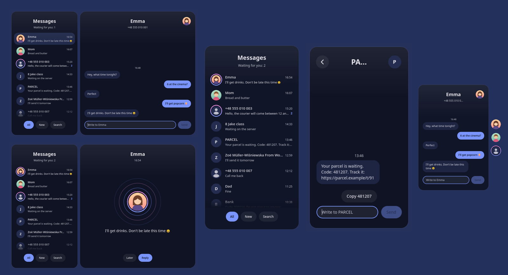

<h3 align="center">Deadzone Studio</h3>

Open-source tools for Linux desktops and Android phones, made in Poland. 
<a href="https://deadzone.m4rtwy-home.pl">deadzone.m4rtwy-home.pl</a>

A dead zone is where the signal does not reach. Our desktops were one: the phone in one hand, Linux on the screen, and
nothing between them. So we started filling it.

- **[Pairlume](https://github.com/deadzone-studio/pairlume)**: your Android phone and your Hyprland desktop as one: texts, calls and their voice on the computer, paired by a shake. [Download](https://github.com/deadzone-studio/pairlume/releases)
- **[ricepick](https://github.com/deadzone-studio/ricepick)**: a catalog of Hyprland rices you can browse, preview and download. It never runs anything a rice ships. ([the catalog](https://github.com/deadzone-studio/ricepick-db))
- **[CS Simulator](https://github.com/deadzone-studio/CSSimulator)**: open CS cases, upgrade skins and do daily missions, all with pretend money, in a browser.

**How we build:** your things stay with you (no account, no server of ours), everything is off until you say yes,
nothing runs that you did not ask for, and the code is public from the first line.

Found a bug? Open an issue in the project. Anything else: [m4rtwy.developer@gmail.com](mailto:m4rtwy.developer@gmail.com).
